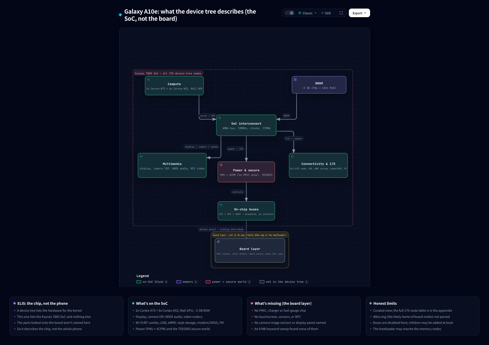

# Galaxy A10e (SM-A102U) device trees: hardware enumeration

A companion to [`A10e-teardown.md`](A10e-teardown.md) - the hardware side, read out of the device trees.

Static, read-only. Read on 2026-10-27 and 2026-10-28 with a hand-written FDT reader (`python3 -I`), no `dtc`. The files are `dt.img` (the base tree), `dtbo.img` (board overlays) and `kernel_config.txt`, all from the stock SM-A102U firmware package, build `A102USQSDAVD1` (the signer-string comparison below also uses that build's boot and recovery images and the AT&T build's boot image). They sit under `out/extracted/` in a working copy and are not in this repo, so those paths are provenance, not links. `kernel_config.txt` is the config blob embedded in the kernel inside that build's `boot.img` (byte-identical to the IKCFG blob in that kernel). Every claim below that says "in the file" was read from one of those files, and it says which. Items marked "likely", "inference" or "general knowledge" are interpretation, not something a file states.

The device trees in one picture: the base tree (`dt.img`) holds the SoC blocks, the Wi-Fi/BT combo is the one off-SoC radio it names, and the board parts (PMICs, touch, sensors, camera modules, panel, NFC) come from the overlays in `dtbo.img`:



## The big finding

**The base tree (`dt.img`) describes the Exynos SoC only. The board-level parts are in the overlays in `dtbo.img`.** In `dt.img` there are 170 nodes with a `compatible` (of 430 nodes), and every one is either a SoC block, a CPU core, a reserved-memory region, or Samsung software plumbing, with three exceptions. `scsc_wifibt` is the interface to the Wi-Fi/Bluetooth combo radio, the one external-radio interface the base tree names. `usim_det` (SIM detect) and `fm@14840000` (FM radio) are named without the file saying whether they are on the SoC.

In the base tree the I2C, SPI, UART, USI, speedy and MMC controllers have no child nodes at all (checked: zero children under any `hsi2c`, `i2c`, `spi`, `uart`, `usi`, `speedy` or `dwmmc` node), and all 36 of them are `status = "disabled"` (hsi2c 10, i2c 8, uart 6, spi 5, usi 3, dwmmc 3, speedy 1; the only other two disabled nodes in the file are the USB wrapper and the USB PHY). So no PMIC, fuel gauge, charger, touchscreen, accelerometer, magnetometer, image-sensor chip, audio codec, NFC chip, or display panel is named anywhere in `dt.img`. A keyword sweep over the whole 8 MB image found only pin-group names, input-booster key names and a few other strings (full term list and hits in the sweep note below).

`dtbo.img` is where those parts are named. It turns on 19 of the 36 controllers and attaches the chips to them (next section).

## Board layer (`dtbo.img`)

`dtbo.img` (8,388,608 bytes) is an Android dt_table (magic 0xd7b7ab1e, total_size 0x41e5c, page_size 0x800) with 3 entries, each one FDT overlay (version 17, last_comp_version 16; three 0xd00dfeed magics in the file). All three have `board_id` 0 and `board_rev` 0 and a root compatible pair of `samsung,A10E USA SINGLE 0N` and `samsung,EXYNOS7884B` (N is 0, 1 or 2 to match the entry), and each has its own hardware-revision range in `dtbo-hw_rev` and `dtbo-hw_rev_end`.

| Entry | dt_size | dt_offset | `dtbo-hw_rev` to `dtbo-hw_rev_end` | First root compatible | Nodes |
|---|---|---|---|---|---|
| 0 | 0x15ef0 | 0x80 | 0x0 to 0x0 | `samsung,A10E USA SINGLE 00` | 584 |
| 1 | 0x15ef0 | 0x15f70 | 0x1 to 0x1 | `samsung,A10E USA SINGLE 01` | 584 |
| 2 | 0x15ffc | 0x2be60 | 0x2 to 0xff | `samsung,A10E USA SINGLE 02` | 586 |

Each overlay also has a `model` string under `/fragment@model`: "Samsung A10E USA SINGLE 0N board based on EXYNOS7884B" (N is 0, 1 or 2 to match the entry), and a `samsung,exynos7884B-oscclk` fixed clock. The device tree doesn't say what "SINGLE" means. The teardown pairs the sales string `USA:SINGLE` with the carrier build and `USA:OPEN` with the unlocked one, and the live phone reports `ro.multisim.simslotcount = 1`, so it fits either reading. The same 54 nodes with a `compatible` (the root plus 53) appear in all three entries. Entries 0 and 1 differ only in the root compatible, the hardware-revision range, the model string and the LIS2DS `st,orientation` values. Besides its own root compatible, revision range and model string, entry 2 differs from entry 1 in the camera GPIO properties, some sleep-state pin groups, and an added `fm@14840000` node with FM LNA properties (`elna_gpio`, `num-trfon-freq`, `val-trfon-freq`, `spur-trfon-freq`). The table below is the same in all three entries.

Each overlay is a list of `fragment@N` nodes. A fragment patches a base-tree node (the `target` phandle is filled in from `__fixups__` using a label that dt.img's `__symbols__` resolves, such as `i2c_4`) or the root (`target-path = "/"`). The "attaches to" column gives the base-tree node. The middle column is what the overlay names (a compatible string or node name, read from the file); the last column is a reading of it, so treat it as inference from the compatible string unless it says otherwise.

| Group | Named in the overlay | Attaches to | Reading (inference) |
|---|---|---|---|
| Main PMIC | `samsung,s2mpu08mfd` (`s2mpu08mfd@00`, has `acpm-ipc-channel`) | `speedy@11CE0000`, set `okay` | Samsung S2MPU08 power-management chip, likely reached through ACPM |
| Other power chips | `samsung,s2mpb03pmic` (`s2mpb03@56`); `i2c,s2dps01` (`s2dps01@66`) | `/hsi2c@13920000`; `/i2c@13850000` | Two more power chips; what each one powers is not stated |
| Charger, fuel gauge, USB-PD | `samsung,s2mu205mfd` (`s2mu205@3d`, has a `flash_led` child); `samsung,s2mu205-charger`; `samsung,s2mu205-fuelgauge` (`@3B`); `sec-usbpd,i2c` (`usbpd-s2mu205@3C`); `samsung,sec-battery` | MFD on `/i2c@13840000`; fuel gauge and USB-PD on `/i2c@13830000`; charger and battery nodes under the root | One S2MU205 chip family doing charger, fuel gauge and USB-PD, plus a battery node that names the charger and fuel gauge. The charger node's `status` is the string `"disable"`, as written in the file |
| Audio | `codec,cod3035x` (`cod3035x@03`); `samsung,exynos7885-cod3035` (`sound`, `okay`); `siliconmitus,sma1301` (`sma1301@1e`); `snd-soc-dummy` | codec under `speedy@11CE0000`; amp on `/i2c@13860000` | COD3035X is the audio codec; SMA1301 is likely a speaker amplifier |
| Touch and display | `himax,hxcommon` (`himax_ts@48`, firmware `tsp_himax/hx83102d_a20e.fw`); panel timing node `hx83102d_hdp` (no `compatible`; `resolution` 720 x 1560, `data_lane` 4, `timing,refresh` 60) | touch on `/i2c@13870000`; panel node under the root | Himax touch controller; the panel driver chip is likely a Himax HX83102D (the node and firmware names match) |
| Sensors | `st,lis2ds` (`lis2ds@1D`); `sharp,gp2ap110s` (`gp2a@39`); `coreriver,tc3xx-grip` (`tc3xxk@20`, firmware `coreriver/tc305k_a10e_grip.fw`); `samsung,sec-ap-thermistor` | `/i2c@13890000`; `/i2c@13880000`; a bit-banged `i2c-gpio` bus `i2c@20`; the thermistor reads an ADC channel | An accelerometer, a proximity sensor, a grip sensor and an AP temperature thermistor |
| Cameras | `samsung,sensor-module-4ha` (`position` 0) with `samsung,exynos5-fimc-is-cis-4ha`; `samsung,sensor-module-5e9` (`position` 1) with `samsung,exynos5-fimc-is-cis-5e9`; `samsung,exynos5-fimc-is-actuator-dw9808`; `samsung,rear-eeprom-i2c`; `samsung,sensor-flash-gpio` | `/hsi2c@138B0000` (4HA); `/hsi2c@138A0000` (5E9); `/hsi2c@138D0000` (actuator, EEPROM) | Two camera sensors, likely Samsung S5K4HA and S5K5E9 (names). Position 0 as rear and 1 as front is general knowledge about Samsung's numbering, not stated. The actuator is a lens focus driver (its name says actuator) |
| NFC | `sec-nfc` (`sec-nfc@27`, with `sec-nfc,*` GPIO properties) | `/hsi2c@13930000` | An NFC controller node. It is in all three entries; whether a part is fitted on this model is not stated |
| Modem, SIM, GNSS | `sec_modem,modem_pdata` (`mif_pdata`, `mif,name = "s327ap"`, `mif,link_name = "shmem"`); `samsung,exynos-shm_ipc`; `samsung,gnss_shdmem_if`; 2x `samsung,exynos-shd-ipc-mailbox`; `usim_det` with `mif,num_of_usim_det = 1` | the root | Cellular modem and GNSS links over shared memory; one SIM-detect line |
| Other | `sec_vib`; `gpio-keys` (`button@1` to `button@3`); `samsung,usb-notifier`; a node named `muic` (two flag properties, no `compatible`); `samsung,argos`; `fpcb_type` | the root | A vibrator, three buttons, USB-related glue |

What the overlays do to the base-tree controllers: they set `status = "okay"` on 7 of the 8 `i2c`, 5 of the 10 `hsi2c`, all 3 `usi`, 1 of the 6 `uart` (`/uart@13820000`), `speedy@11CE0000`, and 2 of the 3 `dwmmc` (0 and 2), which is 19 of the 36. `hsi2c_2` (`/hsi2c@138C0000`) and `dwmmc1` are written `disabled`, and no overlay fragment targets any `spi` node. The overlays also set the USB controller (`/usb@13600000`), the USB PHY (`/phy@135D0000`), `abox` and `abox_gic` to `okay`.

**SoC name.** The base tree is the Exynos 7885 platform's (root compatible `samsung,exynos7885`). The overlays in `dtbo.img` name the part as EXYNOS7884B. That could be a sibling part sharing the 7885 base, but that is a guess, and why the base tree uses the 7885 name is not stated. `kernel_config.txt` sets both `CONFIG_SOC_EXYNOS7885=y` and `CONFIG_SOC_EXYNOS7884A=y`; those flags are listed here without trying to reconcile them.

## Container and file facts (`dt.img`)

| Item | Value |
|---|---|
| dt_table magic | 0xd7b7ab1e, total_size 0x15ce0, 1 entry, page_size 0x800 |
| dt entry | dt_size 0x15ca0, dt_offset 0x40, id 0, rev 0 |
| FDT | magic 0xd00dfeed at 0x40, totalsize 89,248 (0x15ca0), version 17, last_comp_version 16, 430 nodes |
| Number of FDTs in the 8 MB file | 1 (only one 0xd00dfeed magic anywhere) |
| Root compatible | `samsung,armv8`, `samsung,exynos7885` |
| Root `model` | **None.** The root has no `model` property, and no node anywhere in `dt.img` has one. Root props are only `compatible`, `dtb-hw_rev` (0), `dtb-hw_rev_end` (0xff), `interrupt-parent`, `#address-cells`, `#size-cells`. The read: the dtb is tagged for hardware revs 0 through 255, i.e. any rev. |
| `chosen/bootargs` | see "Bootargs" below |

The file after the FDT (0x15ce0 onward) is a `SignerVer02` block (a Samsung signer, likely) plus an Android Verified Boot footer, not more device tree. Printable strings in it: `SignerVer02`, `50702675R`, `A102USQSDAVD1`, `20220405200203`, `SM-A102U_NA_ATT_GBL0`, `SRPSB15A013`, `dt.img`, then `AVB0` / `avbtool 1.1.0` / sha256 and an `AVBf` footer at 0x7fffc0. Interpretation (not stated in the file): `20220405200203` looks like a build timestamp of 2022-04-05 20:02:03. If that is KST (UTC+9, inference), it is 11:02:03 UTC, within two seconds of the extracted `dt.img` file's modification time, 2022-04-05 11:02:05 UTC (from `stat`). The signer block in `boot.img` carries a different stamp (`20220405200120`), which fits a per-image build time.

`SM-A102U_NA_ATT_GBL0` is not a carrier marker. The same string sits in the signer block of both the T-Mobile build (`A102USQSDAVD1`, the build this appendix covers, per the teardown) and the AT&T build (`A102USQUGCWH1`, found in its `boot_GCWH1.img`), and also in this build's `boot.img`, `recovery.img` and `dtbo.img`. What it means is unknown.

## Highlights

**CPU (8 cores, from `/cpus` in `dt.img`, all `enable-method = psci`)**

| Cluster (MPIDR affinity) | Cores | Core type |
|---|---|---|
| 0 | `cpu@0`, `cpu@1` | 2x ARM Cortex-A73 |
| 1 | `cpu@100`, `cpu@101`, `cpu@102`, `cpu@103` | 4x ARM Cortex-A53 |
| 2 | `cpu@200`, `cpu@201` | 2x ARM Cortex-A53 |

That is 2x A73 + 6x A53. Logical IDs: A53s are 0 to 5, A73s are 6 and 7 (property `logical-id`). The two cluster-2 A53s carry a `sched_skip` property (meaning not checked). Clock speeds are not in these nodes. The tree's own `cpu-map` groups the cores differently from the MPIDR affinity above: `cluster0` is the two A73 and `cluster1` is all six A53.

**RAM (from the `memory@` nodes in `dt.img`, `#address-cells = 2`, `#size-cells = 1`)**

| Node | Base | Size |
|---|---|---|
| `memory@80000000` | 0x80000000 | 0x3da00000 = 986 MiB |
| `memory@C0000000` | 0xC0000000 | 0x40000000 = 1024 MiB |
| `memory@880000000` | 0x8_80000000 | 0 (empty) |
| `memory@900000000` | 0x9_00000000 | 0 (empty) |

Sum = 2,107,637,760 bytes = 2010 MiB = 1.96 GiB (script-computed). It is exactly 2 GiB minus a 38 MiB hole between 0xBDA00000 and 0xC0000000, and the second bank ends exactly at 0x1_00000000. The inference: a 2 GiB part with 38 MiB carved out. Caveat (unverified guess): Samsung bootloaders often rewrite the memory nodes at boot, so this is what the file says, not proof of the installed RAM.

**Model string:** none in `dt.img` (see above). The identity strings in `dt.img` are the root `compatible` (`samsung,exynos7885`), the bootarg `androidboot.hardware=samsungexynos7885`, and the signer footer (`SM-A102U_NA_ATT_GBL0`, which is not a carrier marker, see above). The overlays in `dtbo.img` do have a `model` string (see the board layer section).

## Priority classes

"In dt.img?" and "In dtbo.img?" are separate questions: the base tree names none of the board chips, and the overlays name most of them.

| Class | In dt.img? | In dtbo.img? | What the files have |
|---|---|---|---|
| PMIC / power management | No chip named | Named | dt.img: `samsung,exynos7885-pmu` + `syscon` at `/system-controller@11c80000` and `samsung,exynos-pmu` are the SoC's own power-management register block, **not** a PMIC chip. `samsung,exynos-acpm` (+ `-ipc`, `-dvfs`) is the SoC's power co-processor. `samsung,exynos-speedy` at `/speedy@11CE0000` is `disabled` in dt.img; Samsung uses it as a proprietary PMIC bus (general knowledge). dtbo.img: the same node is `okay`, with children `s2mpu08mfd@00` (`samsung,s2mpu08mfd`, carries `acpm-ipc-channel`, so ACPM is likely the path to it) and `cod3035x@03` (the audio codec). Two more power chips sit on I2C (see the board layer table). Bootarg `pmic_info=0x3` is a flag handed to the kernel (meaning not verified). |
| Fuel gauge / charger | **None** | Named | dt.img: no node, no string. dtbo.img: `samsung,s2mu205-fuelgauge`, `samsung,s2mu205-charger`, `samsung,s2mu205mfd` and `samsung,sec-battery` (details in the board layer table). |
| Touchscreen controller | **None** | Named | dt.img: the only "touch" hits are `TOUCHKEY` / `TOUCH` / `MULTITOUCH` labels (`input_booster,label`) under `/input_booster`, which is likely a software CPU-boost helper. dtbo.img: `himax,hxcommon`. |
| Accelerometer / magnetometer / other sensors | **None** | Likely accelerometer, proximity and grip; no magnetometer | dt.img: no sensor nodes. `/adc@120A0000` (`samsung,exynos-adc-v3`) is the SoC's general ADC; thermal zones `BIG`, `LITTLE`, `G3D` are the SoC's own temperature sensors. dtbo.img: `st,lis2ds`, `sharp,gp2ap110s`, `coreriver,tc3xx-grip`. The ADC (`exynos_adc`) is referenced by the battery node, the codec (jack detect, `adc-ear` and `adc-gdet`) and the AP thermistor (`adc-ap-temp`). No magnetometer or gyroscope compatible appears in any overlay (byte search for magnet, geomag, gyro, akm, yas5 and mmc3 in all three entries: 0 hits). |
| Camera image sensors | **Not named** | Named | dt.img: SoC side only: `/fimc_is@14450000` ISP, 4x `/fimc_is_sensor@144x0000` interface slots, 4x MIPI CSI D-PHY (`phy_isp_csis0..3`), 3 sensor master clocks (`CIS_CLK0..2`), `/gdc` distortion correction. dtbo.img: sensor modules `4ha` and `5e9`, a DW9808 actuator and a rear EEPROM; the overlay sets interface slots 0 and 1 (`/fimc_is_sensor@14410000`, `/fimc_is_sensor@14400000`) to `okay` and slots 2 and 3 to `disabled`, which fits two cameras. |
| Audio codec | **Not named** | Named | dt.img: SoC ABOX audio DSP (`/abox@0x14A50000`, 8 read + 5 write DMA channels). Pin groups `aud-codec-mclk`, `aud-codec-bus`, `aud-spk-bus`, `aud-fm-bus`, `aud-loopback-bus`, `aud_dmic_on/off` hint that an external codec / speaker amp / DMIC exist on the board (a read, not stated), but no codec node. dtbo.img: `codec,cod3035x` and `siliconmitus,sma1301`. |
| NFC | **None** | `sec-nfc` node | dt.img: no node, no string. dtbo.img: `sec-nfc` on `/hsi2c@13930000`; whether a part is fitted is not stated. |
| Wi-Fi / Bluetooth | Interface only | Chip not named | dt.img: `/scsc_wifibt@120c0000` (`samsung,scsc_wifibt`): Samsung SCSC combo interface, with interrupt names `MBOX`, `ALIVE` and `WDOG` and a `samsung,syscon-phandle` (reading: reached over an SoC mailbox; "mailbox" is a reading of the name), 4 MiB reserved at 0xe9000000 (`exynos,wifibt_if`) and `exynos,btabox_rmem` for BT audio. Likely Samsung SLSI's in-house combo chip (general knowledge); exact chip not named. dtbo.img: no Wi-Fi or Bluetooth chip either; the only Wi-Fi mentions are `net_boost` labels for the `wlan0` interface. |
| eMMC / UFS / SD | eMMC-style, controllers only | Hosts 0 and 2 on | No UFS anywhere (0 hits for "ufs" in either file). Three DesignWare MMC hosts, all `disabled` in dt.img: `dwmmc0@13500000` (has a `cmdq_mem` region), `dwmmc1@13510000`, `dwmmc2@13550000`. The base tree has pin groups `sd0-bus-width8` + `sd0-rdqs`, `sd1-bus-width4` and `sd2-bus-width4`, but the three `dwmmc` nodes carry no `pinctrl` reference to them, so pairing `dwmmcN` with `sdN` in dt.img is by number, not by the file. The overlay makes the pairing: `dwmmc_0` is `okay` with `sd0_*` pin groups (including `sd0_bus8` and `sd0_rdqs`), `supports-8bit`, `non-removable`, `mmc-hs400-1_8v` and `support-cmdq`, so likely eMMC. `dwmmc_2` is `okay` with `sd2_*` pin groups, `supports-4bit`, `card-detect-gpio`, `sec-sd-slot-type` and a `dwmmc2_cd_ext_irq` pin group, so likely the SD card slot. `dwmmc_1` stays `disabled`. Also `samsung,mmc-srpmb` (secure RPMB over MMC) and `samsung,exynos-fmp` (`exynos,host-type = mmc`, `exynos,block-type = mmcblk0p`). The flash chip itself is not named. |
| USB / Type-C | SoC USB only | USB on; USB-PD node | dt.img: `/usb@13600000` (`samsung,exynos-dwusb`) + `/usb@13600000/dwc3` (`synopsys,dwc3`) + `/phy@135D0000` (`samsung,exynos-usbdrd-phy`, `has_combo_phy = 1`), controller `status = disabled`. No Type-C controller, muic or tcpc node in dt.img. Bootarg `ccic_info=0x1` is a flag handed to the kernel; Samsung uses "CCIC" for its Type-C controller chip (general knowledge), but what the flag means here, and which port type the phone has, isn't verified. dtbo.img: `usb@13600000` and `phy@135D0000` are `okay`; `dwc3` has `dr_mode = "otg"` and `maximum-speed = "high-speed"` (USB 2.0 speed, general knowledge, so the combo PHY property does not mean a USB 3 port here). `sec-usbpd,i2c` (`usbpd-s2mu205@3C`, with `usbpd,usbpd_int`) is a USB-PD controller node, so a USB-PD controller exists. Also `samsung,usb-notifier` and a node named `muic` (no `compatible`). |
| Display panel | **Not named** | Panel node, no `compatible` | dt.img: SoC side only: `/dsim@0x14870000` (MIPI DSI host), `/decon_f@0x14860000` (display controller), 4x `/dpp@...` planes, `phy_m4s4_dsi`. The `dsim` node has no child, so no panel node. dtbo.img: a panel timing node `hx83102d_hdp` (720 x 1560, 4 DSI data lanes) with panel power and reset sequences under `decon_board`. |

Other hardware seen in `dt.img`: GPU `arm,mali` at `/mali@11500000` (model not stated in the device tree; `kernel_config.txt` has `CONFIG_MALI_TMIX=y` and `CONFIG_MALI_TMIX_R16P0=y`, and TMIX is Arm's driver codename for the Mali-G71, which is general knowledge; the MP2 core count is not in any file read here, and "Mali-G71 MP2" for the Exynos 7885 is general knowledge); video codec `samsung,mfc-v6`; JPEG codec, 2D blitter and scaler; an FM radio block `samsung,exynos7885-fm` (with an external LNA gpio, `fm-lna-en`); cellular modem and GNSS reserved RAM (`exynos,modem_if` 0xf5400000, 136 MiB; `exynos,gnss_if` 0xffc00000, 4 MiB); two SIM-detect lines in the base tree (`samsung,exynos-usim-detect` with usim0 and usim1 detect levels, pin groups `sim0_det_gpio` on `gpa2-6` and `sim1_det_gpio` on `gpa2-5`; the base tree is generic, so this is not evidence of a second SIM slot, and the overlays set `mif,num_of_usim_det` to 1 with a single `mif,usim-det0-gpio`; whether "SINGLE" in the board name means single-SIM is not stated); secure world (`samsung,teegris`, `samsung,exynos-tee`, `/reserved-memory/tima_region`).

## Bootargs (`/chosen/bootargs`, verbatim, treat as data)

```
console=ram skip_initramfs rootwait ro init=/init clk_ignore_unused bcm_setup=0xffffff80f8e00000 androidboot.hardware=samsungexynos7885 androidboot.selinux=permissive ess_setup=0x86000000 ecd_setup=disable androidboot.debug_level=0x4948 firmware_class.path=/vendor/firmware reserve-fimc=0xffffff80fa000000 pmic_info=0x3 androidboot.cp_reserved_mem=ON ccic_info=0x1 epx_activate=true
```

These are the strings as shipped in the file. Samsung's bootloader normally edits bootargs before the kernel sees them (unverified guess), so do not read `androidboot.selinux=permissive` as the running device's state. (The main teardown confirms the live device runs Enforcing.)

## Sweep note

The keyword sweep (raw bytes of the whole 8 MB `dt.img`, case-insensitive) used 32 terms: max77, s2mpu, s2mu, fuel, gauge, charger, battery, tsp, synaptics, himax, melfas, zinitix, focal, goodix, imx, s5k, accel, gyro, magnet, proximity, nfc, codec, tcpc, typec, muic, panel, sm-, touch, ccic, pmic, wifi, ufs. Six of them hit: `sm-` x1 (the signer footer), `touch` x3 (input-booster key names), `codec` x12 (the 4 `aud-codec-*` pin groups, `mclk`, `mclk-idle`, `bus` and `bus-idle`, each matched 3 times: node name, `__symbols__` name and `__symbols__` path), `ccic` x1 and `pmic` x1 (both in bootargs), `wifi` x6 (the `wifibt` nodes). The other 26 terms had zero hits. The sweep proves absence from `dt.img` only, not from the phone, and not from `dtbo.img`, which holds the board parts.

## Full table: every `dt.img` node with a `compatible` (170 of 430)

`status` is the node's own `status` property as shipped (`-` means none). "SoC" means a block inside the Exynos chip. "likely" and "general knowledge" mark interpretation. This table is the base tree only; the overlay nodes are in the board layer section.

| # | node path | compatible | status | what it is |
|---|---|---|---|---|
| 1 | `/` | `samsung,armv8, samsung,exynos7885` | - | Root of the base tree, compatible `samsung,exynos7885`. No model string in dt.img (the overlays in dtbo.img name the part EXYNOS7884B) |
| 2 | `/reserved-memory/framebuffer@0xEC000000` | `exynos,dpu_fb_handover` | - | Reserved RAM for bootloader-to-kernel framebuffer handover (boot splash), likely |
| 3 | `/reserved-memory/modem_if` | `exynos,modem_if` | - | Reserved RAM for the cellular modem (CP) interface |
| 4 | `/reserved-memory/cp_ram_logging` | `exynos,cp_ram_logging` | - | Reserved RAM for modem (CP) crash/RAM logging, likely |
| 5 | `/reserved-memory/gnss_if` | `exynos,gnss_if` | - | Reserved RAM for the GNSS (GPS) interface, likely |
| 6 | `/reserved-memory/tima_region@0xB8000000` | `removed-dma-pool` | - | Generic reserved DMA pool; name is "tima", so likely Samsung TIMA/Knox kernel-integrity region |
| 7 | `/reserved-memory/sec_debug_magic` | `exynos,sec_debug_magic` | - | Samsung debug-magic reserved region (software) |
| 8 | `/reserved-memory/seclog_mem` | `exynos,seclog` | - | Reserved RAM for secure-world log (software) |
| 9 | `/reserved-memory/wifibt_if` | `exynos,wifibt_if` | - | Reserved RAM shared with the Wi-Fi/Bluetooth firmware |
| 10 | `/reserved-memory/abox_rmem@0xE9400000` | `exynos,abox_rmem` | - | Reserved RAM for the ABOX audio DSP |
| 11 | `/reserved-memory/btabox_rmem` | `exynos,btabox_rmem` | - | Reserved RAM for Bluetooth audio through ABOX, likely |
| 12 | `/reserved-memory/crypto` | `exynos8890-ion,crypto` | - | ION reserved heap for crypto (software), likely |
| 13 | `/reserved-memory/video_stream` | `exynos8890-ion,vstream` | - | ION reserved heap for protected video stream, likely |
| 14 | `/pinctrl@11CB0000` | `samsung,exynos7885-pinctrl` | - | SoC GPIO / pin-mux controller bank |
| 15 | `/pinctrl@11CB0000/wakeup-interrupt-controller` | `samsung,exynos7-wakeup-eint` | - | SoC external wake-up interrupt controller |
| 16 | `/pinctrl@148F0000` | `samsung,exynos7885-pinctrl` | - | SoC GPIO / pin-mux controller bank |
| 17 | `/pinctrl@13430000` | `samsung,exynos7885-pinctrl` | - | SoC GPIO / pin-mux controller bank |
| 18 | `/pinctrl@139B0000` | `samsung,exynos7885-pinctrl` | - | SoC GPIO / pin-mux controller bank |
| 19 | `/pd-dispaud@11c84020` | `samsung,exynos-pd` | okay | SoC power domain |
| 20 | `/pd-mfcmscl@11c84040` | `samsung,exynos-pd` | okay | SoC power domain |
| 21 | `/pd-isp@11c84060` | `samsung,exynos-pd` | okay | SoC power domain |
| 22 | `/pd-cam@11c84080` | `samsung,exynos-pd` | okay | SoC power domain |
| 23 | `/pd-g3d@11c840a0` | `samsung,exynos-pd` | okay | SoC power domain |
| 24 | `/dbgdev-pd-dispaud` | `samsung,exynos-pd-dbg` | - | Debug stub for a SoC power domain (software) |
| 25 | `/dbgdev-pd-mfcmscl` | `samsung,exynos-pd-dbg` | - | Debug stub for a SoC power domain (software) |
| 26 | `/dbgdev-pd-isp` | `samsung,exynos-pd-dbg` | - | Debug stub for a SoC power domain (software) |
| 27 | `/dbgdev-pd-cam` | `samsung,exynos-pd-dbg` | - | Debug stub for a SoC power domain (software) |
| 28 | `/dbgdev-pd-g3d` | `samsung,exynos-pd-dbg` | - | Debug stub for a SoC power domain (software) |
| 29 | `/exynos-snapshot` | `samsung,exynos-snapshot` | - | Samsung debug snapshot (software) |
| 30 | `/fimc_is@14450000` | `samsung,exynos5-fimc-is` | ok | SoC camera ISP pipeline (FIMC-IS: ISP, MCSC scaler, VRA, GDC). This is the SoC side, not an image sensor |
| 31 | `/phy_isp_csis0@14510840` | `samsung,mipi-phy-s4` | - | SoC MIPI D-PHY for a camera (CSI-2) input |
| 32 | `/phy_isp_csis1@14510840` | `samsung,mipi-phy-s4` | - | SoC MIPI D-PHY for a camera (CSI-2) input |
| 33 | `/phy_isp_csis2@14510840` | `samsung,mipi-phy-s4` | - | SoC MIPI D-PHY for a camera (CSI-2) input |
| 34 | `/phy_isp_csis3@14510840` | `samsung,mipi-phy-csis` | - | SoC MIPI PHY for camera (CSI-2) input |
| 35 | `/fimc_is_sensor@14410000` | `samsung,exynos5-fimc-is-sensor` | - | SoC camera-sensor interface slot (one of 4). The sensor chip behind it is NOT named in dt.img |
| 36 | `/fimc_is_sensor@14400000` | `samsung,exynos5-fimc-is-sensor` | - | SoC camera-sensor interface slot (one of 4). The sensor chip behind it is NOT named in dt.img |
| 37 | `/fimc_is_sensor@14420000` | `samsung,exynos5-fimc-is-sensor` | - | SoC camera-sensor interface slot (one of 4). The sensor chip behind it is NOT named in dt.img |
| 38 | `/fimc_is_sensor@14430000` | `samsung,exynos5-fimc-is-sensor` | - | SoC camera-sensor interface slot (one of 4). The sensor chip behind it is NOT named in dt.img |
| 39 | `/gdc@0x14630000` | `samsung,exynos5-camerapp-gdc` | - | SoC camera post-processing: geometric distortion correction |
| 40 | `/input_booster` | `input_booster` | okay | Likely a Samsung input-event CPU/memory boost helper (software, not a chip; the file only has the `input_booster` name and `booster_key@N` labels such as `KEY`, `TOUCH`, `MOUSE`) |
| 41 | `/mali@11500000` | `arm,mali` | - | ARM Mali GPU (model not in dt.img) |
| 42 | `/arm-pmu` | `arm,armv8-pmuv3` | - | ARMv8 CPU performance-monitor unit |
| 43 | `/chipid@10000000` | `samsung,exynos7885-chipid` | - | SoC chip-ID register block |
| 44 | `/reboot` | `exynos,reboot` | - | SoC reboot / reset helper |
| 45 | `/cpus/cpu@100` | `arm,cortex-a53, arm,armv8` | - | CPU core: ARM Cortex-A53 (efficiency core, general knowledge) |
| 46 | `/cpus/cpu@101` | `arm,cortex-a53, arm,armv8` | - | CPU core: ARM Cortex-A53 (efficiency core, general knowledge) |
| 47 | `/cpus/cpu@102` | `arm,cortex-a53, arm,armv8` | - | CPU core: ARM Cortex-A53 (efficiency core, general knowledge) |
| 48 | `/cpus/cpu@103` | `arm,cortex-a53, arm,armv8` | - | CPU core: ARM Cortex-A53 (efficiency core, general knowledge) |
| 49 | `/cpus/cpu@200` | `arm,cortex-a53, arm,armv8` | - | CPU core: ARM Cortex-A53 (efficiency core, general knowledge) |
| 50 | `/cpus/cpu@201` | `arm,cortex-a53, arm,armv8` | - | CPU core: ARM Cortex-A53 (efficiency core, general knowledge) |
| 51 | `/cpus/cpu@0` | `arm,cortex-a73, arm,armv8` | - | CPU core: ARM Cortex-A73 (performance core, general knowledge) |
| 52 | `/cpus/cpu@1` | `arm,cortex-a73, arm,armv8` | - | CPU core: ARM Cortex-A73 (performance core, general knowledge) |
| 53 | `/cpus/idle-states/bootcl-cpu-sleep` | `exynos,idle-state` | okay | CPU idle (sleep) state definition |
| 54 | `/cpus/idle-states/nobootcl-cpu-sleep` | `exynos,idle-state` | okay | CPU idle (sleep) state definition |
| 55 | `/psci` | `arm,psci` | - | ARM PSCI power-state firmware interface |
| 56 | `/interrupt-controller@123001000` | `arm,cortex-a15-gic, arm,cortex-a9-gic` | - | ARM GIC interrupt controller |
| 57 | `/timer` | `arm,armv8-timer` | - | ARMv8 generic timer |
| 58 | `/clock-controller@0x12060000` | `samsung,exynos7885-clock` | - | SoC clock controller (CMU) |
| 59 | `/devfreq_mif@17000010` | `samsung,exynos-devfreq` | - | SoC bus/block frequency scaling (devfreq) domain |
| 60 | `/devfreq_int@17000020` | `samsung,exynos-devfreq` | - | SoC bus/block frequency scaling (devfreq) domain |
| 61 | `/devfreq_disp@17000040` | `samsung,exynos-devfreq` | - | SoC bus/block frequency scaling (devfreq) domain |
| 62 | `/devfreq_cam@17000050` | `samsung,exynos-devfreq` | - | SoC bus/block frequency scaling (devfreq) domain |
| 63 | `/devfreq_aud@17000060` | `samsung,exynos-devfreq` | - | SoC bus/block frequency scaling (devfreq) domain |
| 64 | `/devfreq_fsys@17000070` | `samsung,exynos-devfreq` | - | SoC bus/block frequency scaling (devfreq) domain |
| 65 | `/mct@10040000` | `samsung,exynos4210-mct` | - | SoC multi-core timer |
| 66 | `/ITMON@0` | `samsung,exynos-itmon` | - | SoC interconnect error monitor |
| 67 | `/usi@10032000` | `samsung,exynos-usi` | disabled | SoC USI (selects whether a port acts as UART / I2C / SPI) |
| 68 | `/usi@10032004` | `samsung,exynos-usi` | disabled | SoC USI (selects whether a port acts as UART / I2C / SPI) |
| 69 | `/usi@10032008` | `samsung,exynos-usi` | disabled | SoC USI (selects whether a port acts as UART / I2C / SPI) |
| 70 | `/speedy@11CE0000` | `samsung,exynos-speedy` | disabled | SoC SPEEDY serial-bus controller. Likely the Samsung proprietary bus used to reach a Samsung PMIC (general knowledge); `disabled` in dt.img, `okay` in the dtbo.img overlays, where it has the S2MPU08 PMIC and the COD3035X codec as children |
| 71 | `/uart@13800000` | `samsung,exynos-uart` | disabled | SoC UART |
| 72 | `/uart@13810000` | `samsung,exynos-uart` | disabled | SoC UART |
| 73 | `/uart@13820000` | `samsung,exynos-uart` | disabled | SoC UART |
| 74 | `/uart@13920000` | `samsung,exynos-uart` | disabled | SoC UART |
| 75 | `/uart@13940000` | `samsung,exynos-uart` | disabled | SoC UART |
| 76 | `/uart@13980000` | `samsung,exynos-uart` | disabled | SoC UART |
| 77 | `/fmp` | `samsung,exynos-fmp` | - | SoC FMP, likely Flash Memory Protector, a storage encryption engine (the expansion is general knowledge); `exynos,host-type` is mmc |
| 78 | `/smu` | `samsung,exynos-smu` | - | SoC storage security unit, likely |
| 79 | `/dwmmc0@13500000` | `samsung,exynos-dw-mshc` | disabled | SoC DesignWare MMC/SD/SDIO host controller |
| 80 | `/dwmmc1@13510000` | `samsung,exynos-dw-mshc` | disabled | SoC DesignWare MMC/SD/SDIO host controller |
| 81 | `/dwmmc2@13550000` | `samsung,exynos-dw-mshc` | disabled | SoC DesignWare MMC/SD/SDIO host controller |
| 82 | `/hsi2c@138A0000` | `samsung,exynos5-hsi2c` | disabled | SoC high-speed I2C controller (no child devices in dt.img) |
| 83 | `/hsi2c@138B0000` | `samsung,exynos5-hsi2c` | disabled | SoC high-speed I2C controller (no child devices in dt.img) |
| 84 | `/hsi2c@138C0000` | `samsung,exynos5-hsi2c` | disabled | SoC high-speed I2C controller (no child devices in dt.img) |
| 85 | `/hsi2c@138D0000` | `samsung,exynos5-hsi2c` | disabled | SoC high-speed I2C controller (no child devices in dt.img) |
| 86 | `/hsi2c@13920000` | `samsung,exynos5-hsi2c` | disabled | SoC high-speed I2C controller (no child devices in dt.img) |
| 87 | `/hsi2c@13930000` | `samsung,exynos5-hsi2c` | disabled | SoC high-speed I2C controller (no child devices in dt.img) |
| 88 | `/hsi2c@13940000` | `samsung,exynos5-hsi2c` | disabled | SoC high-speed I2C controller (no child devices in dt.img) |
| 89 | `/hsi2c@13950000` | `samsung,exynos5-hsi2c` | disabled | SoC high-speed I2C controller (no child devices in dt.img) |
| 90 | `/hsi2c@13980000` | `samsung,exynos5-hsi2c` | disabled | SoC high-speed I2C controller (no child devices in dt.img) |
| 91 | `/hsi2c@13990000` | `samsung,exynos5-hsi2c` | disabled | SoC high-speed I2C controller (no child devices in dt.img) |
| 92 | `/i2c@13830000` | `samsung,s3c2440-i2c` | disabled | SoC standard I2C controller (no child devices in dt.img) |
| 93 | `/i2c@13840000` | `samsung,s3c2440-i2c` | disabled | SoC standard I2C controller (no child devices in dt.img) |
| 94 | `/i2c@13850000` | `samsung,s3c2440-i2c` | disabled | SoC standard I2C controller (no child devices in dt.img) |
| 95 | `/i2c@13860000` | `samsung,s3c2440-i2c` | disabled | SoC standard I2C controller (no child devices in dt.img) |
| 96 | `/i2c@13870000` | `samsung,s3c2440-i2c` | disabled | SoC standard I2C controller (no child devices in dt.img) |
| 97 | `/i2c@13880000` | `samsung,s3c2440-i2c` | disabled | SoC standard I2C controller (no child devices in dt.img) |
| 98 | `/i2c@13890000` | `samsung,s3c2440-i2c` | disabled | SoC standard I2C controller (no child devices in dt.img) |
| 99 | `/i2c@11CD0000` | `samsung,s3c2440-i2c` | disabled | SoC standard I2C controller (no child devices in dt.img) |
| 100 | `/spi@13900000` | `samsung,exynos-spi` | disabled | SoC SPI controller (no child devices in dt.img) |
| 101 | `/spi@13910000` | `samsung,exynos-spi` | disabled | SoC SPI controller (no child devices in dt.img) |
| 102 | `/spi@13920000` | `samsung,exynos-spi` | disabled | SoC SPI controller (no child devices in dt.img) |
| 103 | `/spi@13940000` | `samsung,exynos-spi` | disabled | SoC SPI controller (no child devices in dt.img) |
| 104 | `/spi@13980000` | `samsung,exynos-spi` | disabled | SoC SPI controller (no child devices in dt.img) |
| 105 | `/iommu-domain_disp` | `samsung,exynos-iommu-bus` | - | SoC IOMMU domain grouping |
| 106 | `/dpp@0x148B1000` | `samsung,exynos7885-dpp` | - | SoC display post-processor plane (DPU DPP) |
| 107 | `/dpp@0x148B2000` | `samsung,exynos7885-dpp` | - | SoC display post-processor plane (DPU DPP) |
| 108 | `/dpp@0x148B3000` | `samsung,exynos7885-dpp` | - | SoC display post-processor plane (DPU DPP) |
| 109 | `/dpp@0x148B4000` | `samsung,exynos7885-dpp` | - | SoC display post-processor plane (DPU DPP) |
| 110 | `/disp_ss@0x14820000` | `samsung,exynos7885-disp_ss` | - | SoC display subsystem sysreg block |
| 111 | `/system-controller@11c80000` | `samsung,exynos7885-pmu, syscon` | - | SoC power-management-unit REGISTER BLOCK (not a PMIC chip) |
| 112 | `/exynos-pmu` | `samsung,exynos-pmu` | - | SoC PMU driver node (not a PMIC chip) |
| 113 | `/phy_m4s4_dsi@0x11c80000` | `samsung,mipi-phy-dsim` | - | SoC MIPI D-PHY for the display (DSI) output |
| 114 | `/dsim@0x14870000` | `samsung,exynos7885-dsim` | - | SoC MIPI DSI host (display link). No panel child node in dt.img |
| 115 | `/decon_f@0x14860000` | `samsung,exynos7885-decon` | - | SoC display controller (DECON). Panel not described in dt.img |
| 116 | `/sysmmu@148C0000` | `samsung,exynos-sysmmu` | - | SoC system MMU (IOMMU) for a block |
| 117 | `/iommu-domain_aud` | `samsung,exynos-iommu-bus` | - | SoC IOMMU domain grouping |
| 118 | `/sysmmu_abox@14A30000` | `samsung,exynos-sysmmu` | - | SoC system MMU (IOMMU) for a block |
| 119 | `/abox_gic@0x14AF0000` | `samsung,abox_gic` | - | ABOX audio-DSP interrupt controller |
| 120 | `/abox@0x14A50000` | `samsung,abox` | - | SoC ABOX audio subsystem (audio DSP + I2S/DMA). No external codec node in dt.img |
| 121 | `/abox@0x14A50000/abox_rdma@0x14A51000` | `samsung,abox-rdma` | - | ABOX audio read DMA (playback) channel |
| 122 | `/abox@0x14A50000/abox_rdma@0x14A51100` | `samsung,abox-rdma` | - | ABOX audio read DMA (playback) channel |
| 123 | `/abox@0x14A50000/abox_rdma@0x14A51200` | `samsung,abox-rdma` | - | ABOX audio read DMA (playback) channel |
| 124 | `/abox@0x14A50000/abox_rdma@0x14A51300` | `samsung,abox-rdma` | - | ABOX audio read DMA (playback) channel |
| 125 | `/abox@0x14A50000/abox_rdma@0x14A51400` | `samsung,abox-rdma` | - | ABOX audio read DMA (playback) channel |
| 126 | `/abox@0x14A50000/abox_rdma@0x14A51500` | `samsung,abox-rdma` | - | ABOX audio read DMA (playback) channel |
| 127 | `/abox@0x14A50000/abox_rdma@0x14A51600` | `samsung,abox-rdma` | - | ABOX audio read DMA (playback) channel |
| 128 | `/abox@0x14A50000/abox_rdma@0x14A51700` | `samsung,abox-rdma` | - | ABOX audio read DMA (playback) channel |
| 129 | `/abox@0x14A50000/abox_wdma@0x14A52000` | `samsung,abox-wdma` | - | ABOX audio write DMA (capture) channel |
| 130 | `/abox@0x14A50000/abox_wdma@0x14A52100` | `samsung,abox-wdma` | - | ABOX audio write DMA (capture) channel |
| 131 | `/abox@0x14A50000/abox_wdma@0x14A52200` | `samsung,abox-wdma` | - | ABOX audio write DMA (capture) channel |
| 132 | `/abox@0x14A50000/abox_wdma@0x14A52300` | `samsung,abox-wdma` | - | ABOX audio write DMA (capture) channel |
| 133 | `/abox@0x14A50000/abox_wdma@0x14A52400` | `samsung,abox-wdma` | - | ABOX audio write DMA (capture) channel |
| 134 | `/abox@0x14A50000/abox_debug@0` | `samsung,abox-debug` | - | ABOX debug (software) |
| 135 | `/abox@0x14A50000/abox_vss@0` | `samsung,abox-vss` | - | ABOX virtual sub-system (software) |
| 136 | `/iommu-domain_is` | `samsung,exynos-iommu-bus` | - | SoC IOMMU domain grouping |
| 137 | `/sysmmu@14540000` | `samsung,exynos-sysmmu` | - | SoC system MMU (IOMMU) for a block |
| 138 | `/sysmmu@14730000` | `samsung,exynos-sysmmu` | - | SoC system MMU (IOMMU) for a block |
| 139 | `/sysmmu@14760000` | `samsung,exynos-sysmmu` | - | SoC system MMU (IOMMU) for a block |
| 140 | `/iommu-domain_mfcmscl` | `samsung,exynos-iommu-bus` | - | SoC IOMMU domain grouping |
| 141 | `/sysmmu@12C50000` | `samsung,exynos-sysmmu` | - | SoC system MMU (IOMMU) for a block |
| 142 | `/smfc@12C00000` | `samsung,exynos8890-jpeg` | - | SoC hardware JPEG codec |
| 143 | `/scaler@12C10000` | `samsung,exynos5-scaler` | - | SoC image scaler |
| 144 | `/fimg2d@12C20000` | `samsung,s5p-fimg2d` | - | SoC 2D blitter |
| 145 | `/scsc_wifibt@120c0000` | `samsung,scsc_wifibt` | - | Interface to the Samsung SCSC combo Wi-Fi/Bluetooth radio, likely reached over an SoC mailbox (a reading of the interrupt names `MBOX`, `ALIVE`, `WDOG`). The radio is off the SoC. Likely Samsung SLSI in-house combo chip (general knowledge). Exact chip not named |
| 146 | `/acpm` | `samsung,exynos-acpm` | - | SoC ACPM firmware co-processor (the expansion "Alive Clock and Power Manager" is general knowledge), likely the part that drives the PMIC for the CPU (general knowledge; the overlay's `s2mpu08mfd@00` carries `acpm-ipc-channel`) |
| 147 | `/mfc0@12C30000` | `samsung,mfc-v6` | ok | SoC multi-format video codec (MFC) |
| 148 | `/acpm_ipc` | `samsung,exynos-acpm-ipc` | - | ACPM mailbox / IPC channel |
| 149 | `/acpm_dvfs` | `samsung,exynos-acpm-dvfs` | - | ACPM frequency/voltage scaling |
| 150 | `/pwm@13970000` | `samsung,s3c6400-pwm` | ok | SoC PWM timer |
| 151 | `/pwm-clock-controller@13970000` | `samsung,exynos-pwm-clock` | - | SoC PWM clock helper |
| 152 | `/watchdog@10060000` | `samsung,exynos8-wdt` | - | SoC watchdog timer |
| 153 | `/usb@13600000` | `samsung,exynos-dwusb` | disabled | SoC USB controller wrapper (Samsung glue around Synopsys DWC3) |
| 154 | `/usb@13600000/dwc3` | `synopsys,dwc3` | - | Synopsys DWC3 USB dual-role controller (on the SoC) |
| 155 | `/phy@135D0000` | `samsung,exynos-usbdrd-phy` | disabled | SoC USB 2.0 / 3.0 combo PHY (property has_combo_phy=1) |
| 156 | `/adc@120A0000` | `samsung,exynos-adc-v3` | - | SoC general-purpose ADC (what is wired to it is not in dt.img; the overlays reference it from the battery, codec and thermistor nodes) |
| 157 | `/rtc@11C90000` | `samsung,exynos8-rtc` | - | SoC real-time clock |
| 158 | `/usim_det` | `samsung,exynos-usim-detect` | - | SIM-card detect logic (SIM0 and SIM1 detect lines; the base tree is generic, not evidence of a second SIM slot) |
| 159 | `/exynos-pm` | `samsung,exynos-pm` | - | SoC power-management driver node (software) |
| 160 | `/amba` | `arm,amba-bus` | - | ARM AMBA bus container |
| 161 | `/amba/pdma0@12020000` | `arm,pl330, arm,primecell` | - | ARM PL330 DMA controller |
| 162 | `/seclog` | `samsung,exynos-seclog` | - | Secure-world log driver (software) |
| 163 | `/tee` | `samsung,exynos-tee` | - | TEE interface driver node (software) |
| 164 | `/teegris` | `samsung,teegris` | - | Samsung TEEGRIS secure-OS interface (software) |
| 165 | `/mmc-srpmb` | `samsung,mmc-srpmb` | - | Secure RPMB access through the MMC controller, so eMMC-style storage, likely |
| 166 | `/fm@14840000` | `samsung,exynos7885-fm` | okay | FM radio receiver block, likely on the SoC (the file does not say; external LNA gpio) |
| 167 | `/exynos-dm@17000000` | `samsung,exynos-dvfs-manager` | - | SoC DVFS manager (software) |
| 168 | `/BIG@10070000` | `samsung,exynos7885-tmu` | - | SoC thermal management unit (temperature sensor for a cluster) |
| 169 | `/LITTLE@10070000` | `samsung,exynos7885-tmu` | - | SoC thermal management unit (temperature sensor for a cluster) |
| 170 | `/G3D@10074000` | `samsung,exynos7885-tmu` | - | SoC thermal management unit (temperature sensor for a cluster) |
