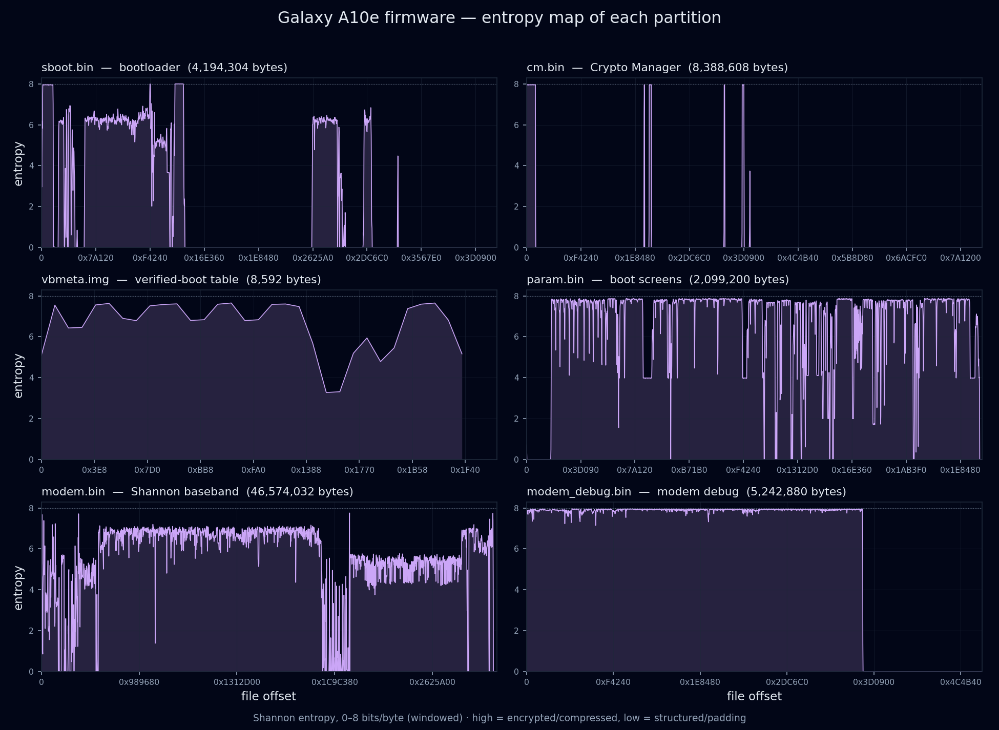

# Inside a locked phone: a Galaxy A10e firmware teardown

This is a hobby walkthrough of the stock firmware on a **Samsung Galaxy A10e (SM-A102U)** - a cheap US-carrier phone that was sitting in a drawer. It started as "could I make this old phone a pet cam?" and turned into a full read of how a modern Android phone decides what it's allowed to run, and why this carrier-locked one is a dead end for custom ROMs.

I'm not affiliated with Samsung in any way, and nobody at Samsung checked this. The [README](README.md#samsung) has a short Samsung section: trademarks, where the firmware comes from, and what isn't in this repo.

Almost all of this is **static analysis** of downloaded firmware. The phone itself only got read-only checks: an [`adb`](https://android.googlesource.com/platform/packages/modules/adb/) property/package/partition sweep while it was booted, and one download-mode session where [`heimdall`](https://git.sr.ht/~grimler/Heimdall) could see the phone but never got the partition table, and flashed nothing. No partition was ever written and no lock was bypassed. The whole point was to *read* the locks and understand them.

There's also a mistake left in on purpose, since it turned out to be the most useful part. An early read got the ARM64 addressing wrong and invented a lock that isn't there. A blind second pass in another session flagged it, and Claude re-checked it and confirmed it.

---

## TL;DR

- The A10e is Project-Treble compliant, but its bootloader is **locked** and OEM unlocking isn't allowed on this unit (`sys.oem_unlock_allowed=0`), so in practice no GSI or custom kernel boots on it. (These US-carrier phones are known for not exposing a working toggle - the files don't prove that part tho.)
- The lock the bootloader actually *enforces* is **verified boot (AVB)**: while it's locked, it refuses any boot/system image not signed by one specific 4096-bit RSA key. Claude carved the key out, matched its fingerprint with [`avbtool`](https://android.googlesource.com/platform/external/avb/) and tied it to the check in the bootloader's own code. Unlocking the bootloader is what would relax this, so the lock state is the real wall.
- Two more locks sit next to it: **Knox Guard** (a carrier/financing flash gate, with a hatch for a Samsung-signed engineering token) and the **TEEGRIS** secure world (a TrustZone OS that runs Samsung's trusted apps). TEEGRIS guards Samsung's secrets more than it guards what boots - the teardown shows one of its modules *reading* the lock bits, not that it's the one in charge of them.
- Claude cross-checked the AVB key and the lock strings against the previous build, a much later (Android 11) build and the *unlocked* sibling model, and they don't change. That's keys and strings, tho - the big OS-major code rewrite wasn't fully disassembled. Samsung's own published kernel source backs the SELinux side.
- The best part is the method and a bug: a wrong assumption about ARM64 addressing quietly turned a partition-table check into a made-up carrier lock in an early draft. That's the main story.

---

## The device

| | |
|---|---|
| Model | SM-A102U (T-Mobile: the live phone's `persist.audio.sales_code` and OMC paths say `TMB`) |
| Build analysed | `A102USQSDAVD1` - bootloader 13, Android 9, April 2022, security patch 2022-01-01 |
| SoC | Exynos 7885-class. The firmware strings say `exynos7885` and `exynos7904`, and the device-tree overlays name **Exynos 7884B**, which is most likely the real chip. Why the other names show up isn't clear - Samsung sharing one base across sibling chips would explain it, but that's a guess. |
| Treble | yes (`ro.treble.enabled=true`, VNDK 28, system-as-root) |
| GSI flavour | reads as `a64_bvN` (32-bit apps, 64-bit binder). The `b` normally means A/B, but this phone has no `ro.build.ab_update` and no slot partitions, so whether that flavour fits an A-only phone isn't confirmed. |
| Bootloader | **locked** (`device_state=locked`, `flash.locked=1`), and OEM unlocking isn't allowed (`sys.oem_unlock_allowed=0`) |

So on paper it's Treble, but the locked bootloader sits in front of all that, and OEM unlocking isn't allowed (more under "Could it run LineageOS?").

The device-tree hardware list (every `dt.img` node that has a `compatible`, the board parts the `dtbo.img` overlays name, and the CPU/RAM layout) is in the [hardware appendix](A10e-hardware-appendix.md).

---

## The firmware package

Samsung firmware ships as six `.tar.md5` bundles. Most files inside are LZ4-compressed (the `.pit` partition map and the OTA `fota.zip` aren't), and a flasher writes each one to a named partition. All six MD5 trailers were recomputed by hand and passed.

| Bundle | Carries | Wipes data? |
|---|---|---|
| **BL** | bootloader (`sboot.bin`), boot screens (`param.bin`), Crypto Manager (`cm.bin`), `vbmeta` | no |
| **AP** | the OS: kernel (`boot.img`), `recovery`, `system`, `vendor`, device trees | no |
| **CP** | the cellular modem (`modem.bin`) | no |
| **CSC** | carrier setup **+ the partition map (PIT)** | yes |
| **HOME_CSC** | the same carrier setup, no PIT | no |
| **USERDATA** | the carrier's starting data partition | yes |

The PIT lists **38 partitions, but only 17 get written** by this firmware. The other 21 are left alone - `EFS`/`SEC_EFS`/`CPEFS` (radio identity and calibration), `PERSISTENT` (the factory-reset-protection store), the modem calibration areas and others. So a stock reflash should leave all of those exactly as they were. That's read off the PIT, not something tried, since nothing got flashed.

---

## The boot chain, in one picture

There's a trust diagram (who checks whom at boot) in the repo at
`.archify/architecture-a10e-trust-20261026-193833/a10e-trust.html`, built from the `vbmeta` descriptors.

```
sboot  ──AVB verify(BOOT, RSA-4096 vs vbmeta)──▶  kernel
  │                                                 │
  │ vbmeta also carries:                            └─▶ dm-verity on system + vendor (hashtrees + FEC)
  │   • SHA-256 hashes for bootloader, cm, boot
  │   • chained descriptors for recovery, dtb, dtbo, product (same key)
```

Live, the phone reports `verifiedbootstate = green`, `device_state = locked`, `selinux = enforcing` and `veritymode = enforcing`, which all line up with the static chain below.

---

## Lock #1 - verified boot (AVB), the one it enforces

`vbmeta` is basically Android's signed table of contents for the boot chain. Reading it with `avbtool` and carving the embedded key out by hand:

- Algorithm: **SHA256_RSA4096**, so a 4096-bit RSA key.
- Key fingerprint (sha1): `e553992a79ab561a4805371cce123d1ee73db21b` - it matches `avbtool`, and a by-hand recompute over the 1032-byte key blob.
- The same key signs the `vbmeta` root **and** every chained partition (`recovery`, `dtb`, `dtbo`, `product`).
- It carries SHA-256 hashes for `bootloader`, `cm` and `boot`, plus **dm-verity** hashtrees (with FEC) for `system` and `vendor`. Those three hash descriptors match the files first-hand.
- The bootloader has a **byte-identical copy of that public key inside itself, in two spots** (file offsets `0x12b070` and `0x322410`; in the 2023 builds, `0x12d070`/`0x322410`). So the key is *embedded in the bootloader image*, and nothing showed it burned into a hardware fuse.

The embedded key ties straight to the gate. A `.data` pointer at file `0x140b28` holds the address of the `0x12b070` key, and it gets loaded at file `0xaf334`, right before the Samsung check that logs `[AVB 2.0 ERR] AVB pubkey is not matched with vbmeta`. File `0xa7a34` is the call site, not the routine: inside the 10 KB verify function at file `0xa71f4`, an indirect `blr x8` calls [libavb](https://android.googlesource.com/platform/external/avb/)'s `validate_vbmeta_public_key` through the ops table. Then it tests the returned `AvbIOResult` (`cmp w0,#1` then `cbnz w0`, so only a `0` result falls through) and the key-is-trusted flag written to the stack at `[x29,#0x4c0]`. On a key that isn't trusted, `cbz w0, 0x8f0473c4` jumps to the block that points at the string *"Public key used to sign data rejected"* (VA `0x8f0aec00`), logs it through libavb's `avb_errorv`, and the path carries result code `5` - libavb's `AVB_SLOT_VERIFY_RESULT_ERROR_PUBLIC_KEY_REJECTED`. One more conditional right after the log (`ldr w0,[x29,#0x148]`, `cbnz`) is shaped like libavb's allow-verification-error hatch, the branch an unlocked phone would take, but that flag wasn't traced back to its source here. This was read in [Ghidra](https://github.com/NationalSecurityAgency/ghidra) on the 2021 `sboot_BAUJ1.bin`, and the verify function, the flash writer and the KG state engine below come out byte-for-byte identical in my own `A102USQSDAVD1` build - a `cmp` of the two sboots puts all 2276 differing bytes outside those ranges. An early pass mis-annotated these branches under the wrong `ADRP` phase, so this time there's a real listing behind it and not a guess. libavb's source-file strings are all there too (`avb_slot_verify.c`, `avb_rsa.c`, `avb_vbmeta_image.c`, descriptors).

Change `system` or `boot` and its hash stops matching `vbmeta`, and `vbmeta` can't be re-signed without Samsung's private key. That's what refuses an unsigned GSI or custom kernel while the bootloader's locked.

To make sure this is the right firmware: the vbmeta digest `avbtool` works out from the staged partitions, `5d354bfd…a7e6`, **matches the live phone's `ro.boot.vbmeta.digest`**. That digest covers the signed vbmeta hash set for the boot chain, so it's strong evidence the boot images on the phone are this firmware.

---

## Lock #2 - Knox Guard, and the engineering-token hatch

Separate from verified boot, the bootloader's **Download mode** (the Odin flashing screen) has a carrier/financing gate. Some of the strings are literally `"KG locked. Not allowed to flash."`, `"KG locked but allow to flash with eng token"`, and even `"blocked due to remaining installment balance"`. KG is **Knox Guard**.

Here's the Download-mode path, read at the correct base:

- The Odin command handler is **`usbd3_rdx_process`** (file `0xc0ecc`). It collects 1024-byte command blocks and hands each one to **`process_packet`** (file `0x6cfc8`), which maps the Odin commands:

  | class | name | what it does |
  |---|---|---|
  | `100`/0x64 | session / control | `get_v3_protocol_ver`, set packet size, `sales_code %s`, model string |
  | `0x65`/'e' | **PIT** | validate + parse the partition table |
  | `0x66`/'f' | **binary flash** | per-partition write, through the flash gate |
  | `0x67`/'g' | end / reboot | |
  | `0x69`/'i' | device info | |

- The flash **verdict** lives in the writer at file `0x6f7ec`, which carries `"KG locked. Not allowed to flash."`. The KG state engine below (file `0x74968`) writes its verdict - the state string `"Normal"` / `"Locked"` / `"Blink"` / … - into a global, and this writer reads that same global, string-compares it to `"Locked"`, and if it matches **and** the eng-token allowance isn't set (a status-bit helper at file `0x88bfc`, selector `1`) **and** the partition isn't `STEADY`, it logs `"KG locked. Not allowed to flash."` and returns `-1`. It also calls the state engine directly elsewhere in the flash path and error-checks the return (`bl`, then `tbnz w0,#0x1f`). So the KG state the engine computes from RPMB is read straight into the flash decision - all in the readable bootloader code.
- The lock **state** comes from a KG state engine at file `0x74968`. It reads two Knox "vault" blocks from **RPMB** (replay-protected secure storage, blocks `0x803` and `0x804`), hash-checks them (a mismatch logs `"KG vaults integrity check fail"` and the state goes `"Broken"`) and works out a state (`[KG] Normal / Locked / Blink / …`). Claude never read this phone's own KG state, since RPMB isn't readable without root.
- There's a hatch for a Samsung-signed **engineering (EM) token** (`"This is KNOX TEST binary. Please download EM-token first!"`): a certificate chain checked in `sboot`, bound to the chip ID and read from the `STEADY` partition. Claude traced its structure and strings, not the RSA/ASN.1 verification itself, so "can't be forged" is how it's designed, not something proven end-to-end.

There also looks to be a separate signed-image check in this flow, apart from KG (going by these strings - it wasn't traced): `sboot` reports `"SW REV. CHECK FAIL(%s) DEVICE: %d, BINARY: %d"` (anti-rollback) plus `"Custom binary blocked by CC Mode."` / `"MDM MODE. CAN'T DOWNLOAD."`.

> **The mistake lives here.** An earlier version reported this gate as a check for a "token magic `0x12349876`". That was wrong (see the method section). `0x12349876` is the Samsung **PIT file identifier**, and the code it pointed at is the partition-table parser next door.

---

## Lock #3 - the TEEGRIS secure world

Tucked inside the bootloader are three small ARM64 ELF programs. Since they're real ELF files (headers and sections), they decompile cleanly, unlike the headerless bootloader around them, so Claude carved them out and read them as standalone binaries.

- **teegris1 (~60 KB) - the CSMC "BFHandler" trusted app** (built `jenkins-BFHandler-exynos7904`). It RSA-verifies a Knox TIMA kernel-module signature (`lkm_sec_info`, `Module verification succeeded`), reads secure-boot measurement fields (`svb_magic`, virtual PCRs, `warranty_string`), and **prints** the `bl_secure_info` fields (`cc_mode`, `em_token`, `curr_bin_status`, `frp_lock`, `kernel_rp`, `warranty_bit`, …) from a `.rodata` table. That field dump is just a readout tho - it was never caught *setting* those bits.
- **teegris3 (~78 KB) - the secure-OS loader** (`startup_loader`). It `mmap`s **`startup.tzar.lz4`**, lz4-unpacks it and loads the trusted apps, and it reports `SECUREOS VERSION`.
- **teegris2 (~9 KB)** - a small stripped helper.

**Where it hit a wall.** `startup.tzar.lz4`, the TEEGRIS secure OS body, gets opened as a **file from the secure filesystem**, not something embedded in sboot (there's no [lz4](https://github.com/lz4/lz4) magic in `sboot.bin` or `cm.bin`). It isn't in the stock image set, so the trusted apps themselves can't be pulled from this download. Claude couldn't pin down *where* it's provisioned either: there's no `TZSW` partition in the 38-entry PIT or the live by-name map, and only sboot's internal name table mentions the name. `cm.bin` is a signed container of several modules (`CryptoManagerV40`, `srpmb_fw`, …), `SignerVer02`. Its encrypted payload gets handled over secure-monitor calls (`smc #0`) and is probably decrypted inside the secure world - that's inferred from the call pattern, not proven.

**Putting the three together:** the phone won't *run* unsigned images while it's locked (AVB, read with confidence), won't *flash* freely once it's carrier/financing-locked (KG, unless you hold a Samsung-signed EM token), and a TEEGRIS module *reports* a whole wall of status and lock bits. AVB is solid. For KG, the chain is now read end to end: the state engine reads the RPMB vaults and classifies the lock state, and the flash writer reads that state and refuses a flash when it's `"Locked"` - so the state is tied to the flash decision in the readable code. The one piece still not proven is the EM-token's own signature check, whose verify routine is reached indirectly and never got auto-formed by the disassembler.

---

## What SELinux actually enforces

The locked bootloader is the wall for flashing and booting, and [SELinux](https://github.com/SELinuxProject) is the fence *inside* the running OS. The boot cmdline asks for `androidboot.selinux=permissive`, which looks alarming at first. But **Android `init` ignores it** on a user build (it only counts when the build sets `ALLOW_PERMISSIVE_SELINUX`), and the kernel has an `ALWAYS_ENFORCE` backstop on top (see the source cross-check). The phone runs Enforcing: `ro.boot.selinux=enforcing`, `ro.build.selinux.enforce=1`. Claude pulled the compiled device policy out of `vendor.img` and read it with [`checkpolicy`](https://github.com/SELinuxProject/selinux) + [`setools`](https://github.com/SELinuxProject/setools):

- sepolicy **v30 MLS**, 2374 types, 95 classes, **39,074 `allow`** rules, 450 `allowxperm`.
- **Zero domains in permissive mode**, which is a proper `user`-build lockdown. That means every domain is enforced - it doesn't mean nothing has broad powers.
- `execmem` (write-then-execute memory) goes to **47 domains**: app sandboxes, the TEE/Knox app domains, *and* a fair spread of system daemons (`shell`, `rild`, `radio`, `bluetooth`, `nfc`, `hal_camera_default`, `hal_drm_default`, `healthd`, `dumpstate`, `install_recovery`, `python`). So it's scoped, but broader than just apps.

**The fence around the secure world holds.** `untrusted_app` has **no `hwservice_manager find`** on any of 13 secure hwservice types (`proca`, `tee`, `teeregistry`, `wsm`, `sem`, `skpm`, `drk`, `wvkprov`, `qchdcpkprov`, `secure_storage`, `keymaster`, …), and **no `chr_file` access to the TrustZone device nodes** (`/dev/tzdev`, `/dev/tziwsock`, …), just `getattr` on `debugfs_trustzone`. The one secure node an app can touch is Knox DAR (`/dev/dek_req`, its data-at-rest encryption). The fence matters a lot here, since most of those TrustZone nodes are mode **0666** (Unix permissions wide open), so SELinux is pretty much the main thing gating them.

**What's actually behind the fence.** Reading `vendor.img` directly with [`debugfs`](https://github.com/tytso/e2fsprogs), the secure-world userspace that ships is **TEEGRIS** - the kernel has `CONFIG_TZDEV=y`, and `CONFIG_TRUSTONIC_TEE` is absent. The real, launched services each map to their SELinux domain: `tzdaemon`, the Knox `proca` HAL, `secure_storage_daemon`, `keymaster@4.0`, `gatekeeper@1.0`, Widevine DRM, and Samsung's `sem`/`drk`/`wsm`/`skpm`/`wvkprov` HALs. All of them are 32-bit (no `/vendor/lib64`). Behind them sit **21 trusted apps** in `/vendor/tee`. A chunk of the policy is just **leftover from a shared template** tho: the Trustonic (`trustonic.tee`, `mcDriverDaemon`), HDCP-provisioning and `secure_element` domains are fenced off, but **no binary for them ships on this image**.

The system partition fills in the rest of that userspace, read the same way (`debugfs` on `system.img`, no mount): `vaultkeeperd` with its `vaultkeeper_server@1.0` HAL, the `rsudaemon` / `rsudrkproxyd` remote-unlock pair, `gatekeeperd`, `keystore`, Samsung's integrity-check daemons (`icd` / `icdaemon` / `epicd`), and a `tlc_server` that's Samsung's own TrustZone/TIMA client (`BnTLCServer`, `libtlc_tz_*`) - not Trustonic's `mcDriverDaemon`, which still doesn't ship. Each one lands in a SELinux domain of the same name (checked with `seinfo -a domain` on the device policy), so the system half fences the secure world the same way the vendor half does.

---

## Could it run LineageOS?

Not on this phone - two separate things are in the way.

**Wall 1 - it can't get in.** The bootloader's locked (`device_state = locked`, `flash.locked = 1`) and OEM unlocking isn't available: `ro.oem_unlock_supported = 1` but `sys.oem_unlock_allowed = 0`. One catch: `oem_unlock_allowed=0` only proves the Developer-options toggle is *off*. AOSP's `PersistentDataBlockService` sets that property straight from the stored toggle state (checked in the Android 9 source; Samsung's build could differ). US-carrier A102U models are well known for not exposing a *working* toggle (so you can't flip it to 1), but that's known about the model, not proven from these files. Either way, while the bootloader's locked, AVB (Lock #1) rejects anything not signed by Samsung's key.

**Wall 2 - Treble's VINTF check would object.** Treble has a boot-time check (VINTF) that only pairs a system image with the phone's vendor code when their declared versions match **exactly**. This vendor declares **target-level 3** (Android 9), and the [LineageOS](https://lineageos.org) 21 (Android 14) GSI only ships compatibility matrices for **levels 4–8** (both reproduced first-hand). So by the exact-match rule there's no level-3 matrix to pair with, and the pairing should get refused - that's what the rule says should happen, not something booted to confirm. Two more details, from a later review of the GSI (it's not on disk anymore, so they weren't re-checked here): the GSI *does* still ship the VNDK-28 runtime (`com.android.vndk.v28.apex` is present), and the kernel gap is the **patch level** (the GSI's `compatibility_matrix.4.xml` wants kernel `4.4.302`, and this phone is on `4.4.111`), not the 4.4 line itself. Whether an Android-9-era GSI would get past the check wasn't tested.

So the GSI isn't going on this phone: the locked bootloader is the wall you actually hit, and VINTF is a second one behind it.

---

## How it was done - the method, and the bug

The bootloader (`sboot.bin`) is a 4 MB ARM64 image with no symbols and no obvious load address. It starts with a 16-byte header: the first word, `0x00000010`, is the header length (same across builds), and the second word is a **per-build image checksum** (`0xfdcdbc1d` here, `0x70dbeb06` in the 2021 build, `0xa20ccd12` in 2023 - so it's not a magic, even tho it looks like one at first). The real reset stub is at offset `0x10`.

**1. Ghidra stalled.** Loaded raw at a guessed base, auto-analysis couldn't tie the "blocked"/"rejected" strings to any code, and cross-references came back empty. Part of that is real (Ghidra doesn't form `ADRP`+`ADD` references in a raw image, so an empty xref list proves nothing), and part was seeding the entry at offset 0, which is the header, not code.

**2. The bug: the `ADRP` page phase.** ARM64 finds its own data with an `ADRP`+`ADD` pair. `ADRP` is **page**-relative: it forms `(PC & ~0xFFF) + offset`, so to know which byte a reference lands on you need the load address **modulo 4 KB** (the "page phase"), not the whole base. An early pass assumed the phase was `0`. For this image it's **`0x800`**, half a page. With the wrong phase, *every* string reference lands **exactly `0x800` bytes (2 KB) off**, on a different string. The disassembly still looks fine and the references just point at the wrong text, so it fails **silently**.

The fix is to measure it: count how many `ADRP`+`ADD` pairs land exactly on the start of a C string under phase 0 and under `0x800`. The repo's `tools/phase_test.py` does that and gets **4249 at `0x800`** vs **1000 at phase 0**, out of 6462 pairs, so one phase clearly wins.

**3. What the bug cost.** Under the wrong phase, the partition-table parser's `0x12349876` check (that constant is the identifier at the top of every Samsung PIT file) had its references land on Knox Guard strings 2 KB away, so it got written up as a "KG token gate." Under the correct phase, that spot cleanly references `guid_part.c` (partition-table integrity), and the real AVB gate and KG path resolve to their own strings.

**4. The base, and what actually opened it up.** `ADRP` gives you the phase, not the base. For the base you need *absolute* pointers: a 13-entry table of partition-name pointers (file `0x12b488`) where every entry equals `base + that string's file offset`. Solving that gives **`0x8ef9e800`**, and `tools/pin_base.py` lands on the same base another way, by voting pointer-minus-landmark across the image (392 votes, next best 115). The phase alone is enough to resolve string references in a hand-written scan, but **pinning the base is what really opened it up** - only then did Ghidra's analyzer follow the in-image pointer tables, auto-form the download-engine and KG functions, and let the caller walks run. The `0x8f000000` chased first is a `ldr;br` jump literal, the VA of file offset `0x61800`.

**5. Reshape the input.** The three TEEGRIS programs are real ELF files sitting mid-binary. Carving them out into standalone files gave the tools headers, sections and cross-references to work with.

If you're poking at a raw image yourself:
- `ADRP` is **page**-relative, so measure the phase instead of assuming zero. A wrong phase fails *silently*, which is how a partition-table check got written up as a carrier lock.
- For a raw image, **pin the load base** too: the phase reads strings, and the base is what makes the disassembler's own analysis work.
- On a raw image, an empty cross-reference list proves nothing - the disassembler may just not have built the references.
- Get a blind second pass. The first pass here invented a lock that wasn't there, a blind pass in another session caught it, and later blind reviews caught more spots where a guess had been written up as fact.

---

## Does it hold up? Cross-checks

One read can fool you (see above), so Claude checked the conclusion against other firmware and Samsung's own source. These compare *string sets and keys*, and the changed code in the big 2023 rewrite wasn't disassembled, so read "same locks" as "same keys and lock strings," not a full code audit.

**1. The previous build.** The prior build `A102USQUBAUJ1` (Oct 2021, about 6 months before this one) differs by **2276 bytes (0.05%) across ~20 regions**: version strings, per-image checksums, regenerated signatures and a few SLSI header fields (one tracks bootloader `11 → 13`). No real code change.

**2. A much later build (OS-major).** The Android-11 build `A102USQUGCWH1` (Aug 2023, an **AT&T** package - a carrier sibling, *not* my T-Mobile phone's build) differs from this one at **30.55% of byte positions** (a straight position-by-position compare, so code that just moved counts too). But the **AVB root key is unchanged** and the **KG/AVB/rollback string sets are byte-identical**. So it's a major rebuild that keeps the same root of trust and the same lock vocabulary, tho the changed code wasn't read instruction-by-instruction.

**3. The encrypted pre-boot stage, across four builds.** `sboot` carries an encrypted blob (roughly file `0x32e0`–`0x1b420`) with a plaintext `[SECLIB] Moonstone-…` tag in front of it, a secure-library stage. Hashing the encrypted body across the four `sboot` images on hand:

| build | OS | variant | encrypted body |
|---|---|---|---|
| BAUJ1 (2021) | Android 9 | T-Mobile | **body A** |
| AVD1 (2022) | Android 9 | T-Mobile | **body A** (identical) |
| GCWH1 (2023) | Android 11 | AT&T | **body B** |
| U1 GCWH1 (2023) | Android 11 | unlocked | **body B** (identical) |

So it's **identical within an Android version and across carrier vs unlocked, and different across the OS-major bump**. The plaintext `[SECLIB] Moonstone` header is the same in all four (a 16-byte field next to it changes in 2023), and the body is uniformly random (H ≈ 7.998/8). That reads as a per-OS-version secure-library stage, not a per-device secret. Whether the 2023 change is a true re-key or just a new IV on the same library can't be told from here, and "signed" is an assumption from the `SECLIB` framing, not something shown.

Plotted out, the encrypted stage is obvious - it's the flat H≈8 band at the very start, before the code drops to ~6. The other flat band near 8, just past the first AVB key, is a 90 KiB data table at `0x12c800`. Its Shannon entropy is high, but its byte counts are very lopsided (chi-square about 137,000, where random bytes give about 255), so it's dense structured data, not encrypted. The two AVB keys are only 1 KB each, so they show up as thin lines:

![sboot.bin entropy - the encrypted [SECLIB] pre-boot blob at H about 8, the ARM64 code around 6, a 90 KiB structured data table that also reads near 8, and the two 1 KB AVB key copies as thin lines](figures/entropy-sboot.png)

And here are six of the firmware images side by side - the mostly-empty Crypto Manager with its thin encrypted bands, the high-entropy boot screens, the Shannon modem, and the tiny structured vbmeta:



**4. The unlocked sibling.** The unlocked `SM-A102U1` and the carrier `SM-A102U` AT&T build (both Aug 2023) differ by ~16% (421 regions, which weren't gone through). What *does* line up matches: the AVB keys and the OEM-unlock-related code/strings (`get_oem_unlock_val`, FRP, carrierid). The clearest difference is the sales string `USA:SINGLE` (carrier) vs `USA:OPEN` (unlocked). So the evidence points to the lock being **provisioning, not a crippled bootloader** - and `get_oem_unlock_val` itself backs that up at the code level: it's the **same 332-byte function** in both builds, same structure (the same OEM-unlock-value gate and the same read of the `PERSISTENT` partition), only its callee and string addresses shifted by the ~16% layout. So the carrier build's unlock getter isn't crippled, it's the same routine - the difference is provisioning. The rest of the ~16% wasn't gone through.

**5. Samsung's own kernel source.** Samsung publishes the GPL kernel source (4.4.177, the `A102U1` release - close to, but not the same build as, the 4.4.111 binary read in Ghidra). The SELinux enforce behaviour is in there: a build-time `-DCONFIG_ALWAYS_ENFORCE=true` makes `sel_write_enforce` force `enforcing`, and `RKP_KDP=y` moves the enforce flag under hypervisor protection. The source matches the mechanism in shape, not line for line. RKP, DEFEX, FIVE and PROCA source are all there, but the TIMA LKMAUTH source is withheld.

**And the modem, real quick:** the `CP` bundle is a Samsung **Shannon** baseband. Parsing its TOC (`tools/modem_toc.py`) gives the usual sections - `BOOT`, `MAIN` (the ~44 MB body), `VSS`, `NV`, `OFFSET` - and `MAIN` carries the version `_ShannonOS_3.5_R7`, the exact same string in both the 2022 and the 2023 modem, so that bump is a refresh of one baseband OS and not a new one. On 5G: the LTE side of `MAIN` is all there (the `SupportedBandEUTRA` capability struct, ~195 `EUTRA` symbols, the `FGI` feature bits), while the matching NR capability structures are just absent - `SupportedBandNR`, `NGRAN`, `nrBand`, `NR_CA` and `measResultListNR` all come back with zero hits in both years. There are scattered `NR` / `NSA` / `gNB` symbols, but that's the shared Shannon codebase, not a band list. So "4G LTE, no 5G" rests on the capability tables themselves here, not on reading tea leaves from stray strings. The modem's CPU core still wasn't dug out.

---

## What couldn't be read

- **The encrypted payloads.** `cm.bin`'s module payload and `sboot`'s `[SECLIB]` body are encrypted, and no key ships in the firmware, so their plaintext can't be recovered statically. The `AP/meta-data/fota.zip` (312 entries, the OTA kit) is encrypted too.
- **The TEEGRIS OS body.** `startup.tzar.lz4` isn't in the image set, so the trusted apps can't be pulled from this download, and which partition it lives on couldn't be pinned down.
- **The startup indirection.** sboot's very first hop goes through a function pointer filled in at runtime in on-chip SRAM (`0x020200a8`), so a static trace can't follow the earliest boot. The later kernel hand-off and the Odin dispatch *were* worked out statically, so those aren't dead ends. Emulating the early path would need QEMU/Unicorn plus modelling the Exynos peripherals and the encrypted stages - a big lift for not much payoff, so it's parked.

---

## Tools

All free and local: Samsung's firmware via [`samloader`](https://github.com/topjohnwu/samloader-rs) for the 2022/2021 builds (the 2023 builds came from a third-party firmware mirror, since Samsung's servers block headless fetches of newer builds); `lz4`, [`simg2img`](https://github.com/anestisb/android-simg2img), `debugfs`, `avbtool` for unpacking; Ghidra (via [REA](https://github.com/morluto/rea)) for analysis, plus [`capstone`](https://github.com/capstone-engine/capstone) (through a `ctypes` wrapper) for the byte-level disassembly and the ADRP phase check; [`binwalk`](https://github.com/ReFirmLabs/binwalk) for a first pass; `checkpolicy` + `setools-console` for the SELinux policy; and small Python scripts for the reference work. All told, the static read came to **897 REA (Ghidra) operations** across two analysis sessions - 616 in the dedicated `sboot` pass and 281 in the follow-ups. `heimdall` saw the phone in download mode, and one session got through the Odin handshake but closed without returning a PIT, so there's no live PIT/flash demo on Linux and nothing got flashed. The only device contact was that read-only `adb` sweep (`getprop`, `pm list`, the by-name map) and the heimdall session, and no partition was written.

## Reproducing

The `tools/` scripts rebuild the maps and disassembly from the firmware bundles (not included here - grab them with `samloader`). Run `tools/phase_test.py <sboot.bin>` first to confirm the page phase (`0x800`), then `tools/pin_base.py <sboot.bin>` for the base, and set the Ghidra image base to `0x8ef9e800`. [`tools/README.md`](tools/README.md) says what each script takes and which build it expects. Derived stuff (boot screens, carved ELFs, the extracted key, the cross-build sboots) went into an untracked `out/` folder here - the scripts take their file paths as arguments, so put yours wherever.
