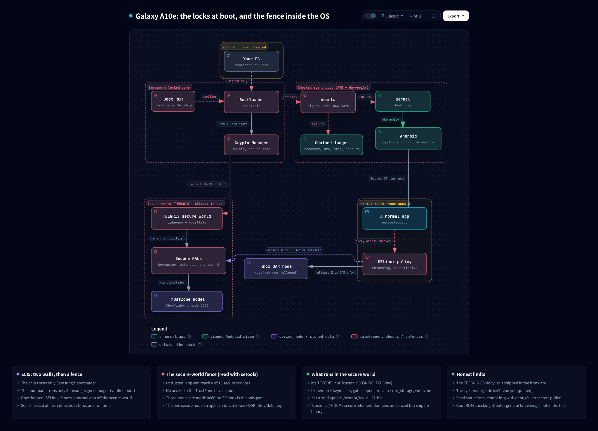
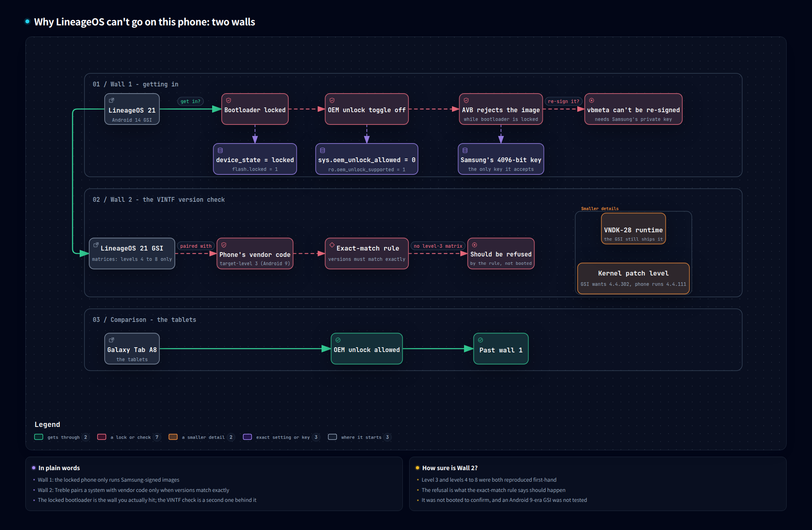
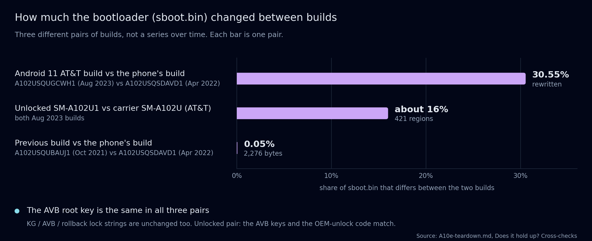
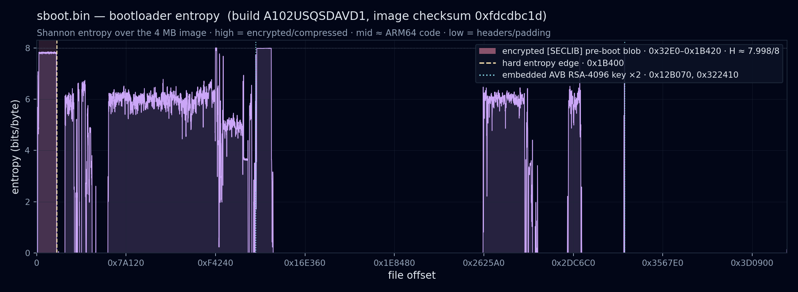

# a10e firmware teardown

poking at the stock firmware on a parked **Samsung Galaxy A10e (SM-A102U)** - a cheap, carrier-locked US phone i had sitting around.

it started dumb and simple: i wanted an old phone as a pet cam for the dogs while i'm at work, running [LineageOS](https://lineageos.org) the way i'd already done on two Galaxy Tab A8s. this one wouldn't play along. turns out it's locked down in a way the tablets never were - so instead of a custom ROM i ended up reading how a modern Android phone decides what it's allowed to boot, and why a carrier-locked one is a dead end for custom ROMs.

the phone, the idea and the questions are mine. the actual reverse-engineering - the disassembly, carving the keys out, the cross-build diffs - was [Claude Code](https://github.com/anthropics/claude-code) driving [Ghidra](https://github.com/NationalSecurityAgency/ghidra) through the [REA](https://github.com/morluto/rea) toolkit, over two sessions. then the whole writeup got a blind second review before i called it done.

the whole shape in one picture - two walls at boot, then a [SELinux](https://github.com/SELinuxProject) fence once it's running:

## what this actually is

almost all of it is **static analysis** of firmware downloaded from Samsung. the only time anything touched the phone it was read-only - an [`adb`](https://android.googlesource.com/platform/packages/modules/adb/) getprop/package/partition sweep while it was booted, and a download-mode session where [`heimdall`](https://git.sr.ht/~grimler/Heimdall) could see the phone but never got the partition table, and flashed nothing. **no partition ever got written, and no lock got bypassed.** i wasn't trying to crack anything. the point was to read the locks and actually get how they work.

there's also a mistake left in on purpose. a wrong ARM64 addressing assumption (the `ADRP` page phase) quietly turned a boring partition-table check into an imaginary "carrier lock" in an early draft. honestly it's the most useful thing in here - it's why the whole writeup went thru a second, blind review, which caught about a dozen more spots where a guess had been written up as fact.

## what it found (short version)

- the A10e is Project-Treble compliant, but the bootloader is **locked** and the OEM unlock toggle is off on this carrier model - so no GSI or custom kernel boots. these US-carrier phones are known for not exposing a working toggle, tho these files don't prove that part.
- the lock it really enforces at boot is **verified boot ([AVB](https://android.googlesource.com/platform/external/avb/))**: while it's locked, the bootloader refuses any boot/system image that isn't signed by one specific 4096-bit RSA key (fingerprint `e553992a79ab561a4805371cce123d1ee73db21b`).
- two more locks sit next to it: **Knox Guard** (a carrier/financing flash gate, with a hatch for a Samsung-signed engineering token) and the **TEEGRIS** TrustZone secure world, which runs Samsung's trusted apps apart from Android (SELinux keeps normal apps away from it, Knox DAR aside).
- the finding holds across the previous build, a much later (Android 11) build, the *unlocked* sibling model, and Samsung's own published kernel source - the AVB key and the lock strings don't change.

why Lineage can't go on, drawn out - the locked bootloader is the wall you actually hit, and the VINTF check is a second one behind it:

and how much the bootloader actually changed between builds - the AVB key never did:

sboot.bin's entropy, plotted - the encrypted pre-boot stage is the flat band right at the start, then the code drops lower and the two copies of the AVB key spike back up:

the full story - real addresses, the AVB key tie, the SELinux policy read, the four cross-checks and the bug - is in **[`A10e-teardown.md`](A10e-teardown.md)**. that's the one to read.

## the hardware

what's actually on the board, pulled from the device tree and its board overlays - the [appendix](A10e-hardware-appendix.md) has the full list:

## what's in here

| path | what it is |
|---|---|
| [`A10e-teardown.md`](A10e-teardown.md) | the full writeup |
| [`A10e-hardware-appendix.md`](A10e-hardware-appendix.md) | the hardware map - every `dt.img` node with a `compatible` (170 of 430), the board parts the `dtbo.img` overlays name, the CPU/RAM layout, SoC vs board |
| `.archify/architecture-a10e-trust-20261026-193833/` | boot-chain trust diagram - who verifies whom at boot - as standalone HTML + PNG |
| `.archify/architecture-a10e-trust-expanded-20261028-122000/` | the same chain plus the SELinux-fenced secure world, HTML + PNG |
| `.archify/architecture-a10e-hardware-20261028-151200/` | the hardware map - SoC blocks and the board layer - HTML + PNG |
| `.archify/workflow-a10e-two-walls-20261028-161640/` | why Lineage can't go on - the two walls - HTML + PNG |
| `.archify/workflow-a10e-adrp-bug-20261028-161541/` | the `ADRP` page-phase bug, step by step - HTML + PNG |
| `figures/` | the entropy plots and the cross-build change chart (made by `tools/entropy_plot.py` and `tools/sboot_diff_chart.py`) |
| `tools/` | small Python scripts that rebuild the maps and disassembly - the ADRP phase sweep (`phase_test.py`), the load-base finder (`findbase.py` / `pin_base.py`), the partition map (`pitmap.py`), the cross-build `sboot` diff (`sboot_diff.py`), the AVB key tie (`vbmeta_key_tie.py`), and others |

the firmware bundles themselves aren't in here - they're big and you can just redownload them. grab them with [`samloader`](https://github.com/topjohnwu/samloader-rs), then point the `tools/` scripts at your own copies. derived stuff (the carved AVB key, boot screens, the TEEGRIS ELFs, the cross-build sboots) rebuilds into `out/`, which is left untracked.

## the method in one line

load `sboot.bin` raw, measure the `ADRP` page phase with `tools/phase_test.py` (it's `0x800`, not `0`), pin the load base at `0x8ef9e800` from the absolute pointer tables, and only then does Ghidra follow the in-image pointers and resolve the AVB and Knox Guard paths to their own strings. the static read ran to **897 Ghidra operations** across the two sessions.

the bug that made it interesting, drawn out - one wrong guess about the page phase, and how measuring it fixed everything after:

## tools

all free and local: [`samloader`](https://github.com/topjohnwu/samloader-rs) for Samsung firmware, [`lz4`](https://github.com/lz4/lz4) / [`simg2img`](https://github.com/anestisb/android-simg2img) / [`debugfs`](https://github.com/tytso/e2fsprogs) / [`avbtool`](https://android.googlesource.com/platform/external/avb/) for unpacking, [Ghidra](https://github.com/NationalSecurityAgency/ghidra) (via [REA](https://github.com/morluto/rea)) plus [`capstone`](https://github.com/capstone-engine/capstone) for the byte-level disassembly and the phase sweep, [`binwalk`](https://github.com/ReFirmLabs/binwalk), and [`checkpolicy`](https://github.com/SELinuxProject/selinux) + [`setools`](https://github.com/SELinuxProject/setools) for the SELinux policy.

## samsung

quick note - i'm not affiliated with Samsung at all. nobody there asked for this, helped with it or looked it over. it's just me and a phone i own.

Samsung, Galaxy, Knox and Exynos are Samsung's trademarks. the names are only here because that's what this is about.

there's no Samsung firmware or code in this repo. the stock bundles came straight off Samsung's servers (the two 2023 builds off a firmware mirror), and you can pull your own with [`samloader`](https://github.com/topjohnwu/samloader-rs). the writeup quotes a few short strings, addresses and a key fingerprint - just enough to show where things are.

the kernel cross-check used Samsung's own kernel source from [opensource.samsung.com](https://opensource.samsung.com) - the 4.4.177 release for the unlocked A102U1.

and none of this unlocks or gets around anything on a Samsung phone. it just reads how the locks work.

## license

the scripts and the write-up are [GPL-3.0](https://www.gnu.org/licenses/gpl-3.0.html) - see [`LICENSE`](LICENSE). the `.archify/` diagrams were made with [archify](https://github.com/tt-a1i/archify), and the generated pages carry its runtime and the [JetBrains Mono](https://github.com/JetBrains/JetBrainsMono) font ([OFL-1.1](https://openfontlicense.org)) under their own licenses.

---

*hobby project. the reverse-engineering was Claude Code with the REA / Ghidra toolchain, and the writeup got a blind review before i called it done.*
